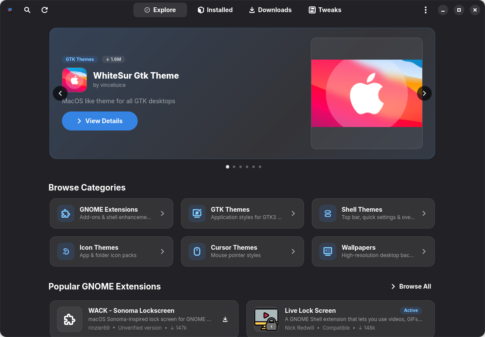
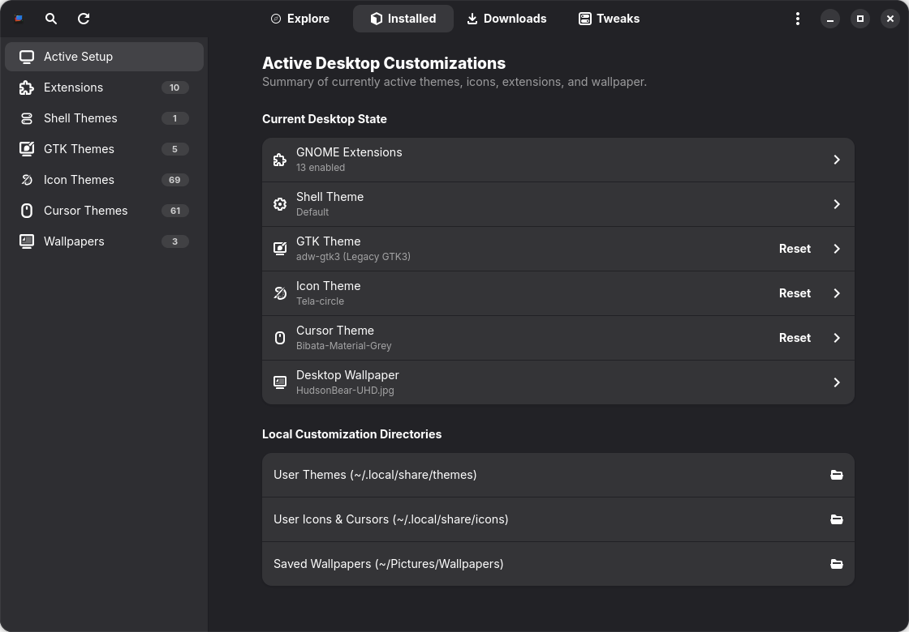
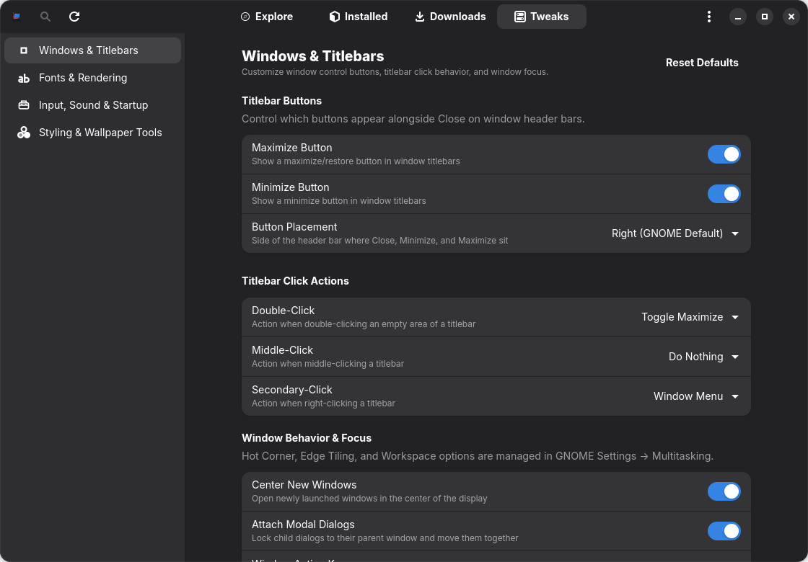
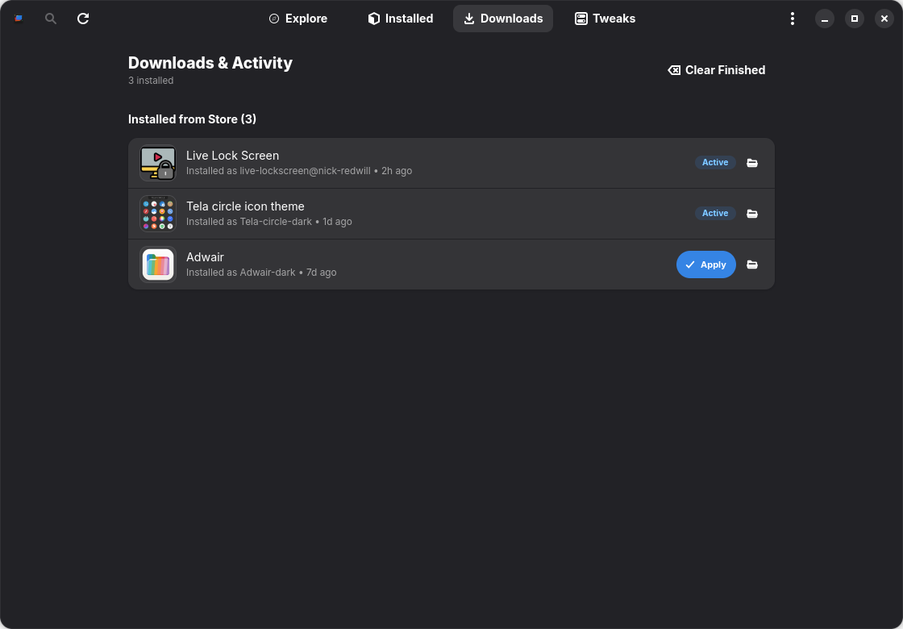

# Adorn

A native **GTK4 & Libadwaita** customization storefront and desktop tweaks manager for modern GNOME desktops (GNOME 45–51+).

[](LICENSE)
[](https://www.gnome.org)

Adorn unifies extension discovery, community themes, icons, cursors, wallpapers, local asset management, and focused desktop tweaks into a single native application following the GNOME Human Interface Guidelines.

---

## Features

- **Explore Store:** Browse, search, and install GNOME extensions (`extensions.gnome.org`) and community themes, icons, cursors, and wallpapers (`gnome-look.org`).
- **Installed Library:** View and manage installed extensions and themes, toggle User Themes integration, and safely manage GTK4 styles.
- **Desktop Tweaks:** Curated power-user settings for window controls, fonts, middle-click paste, startup apps, and styling overrides.
- **Download Manager:** Background download and archive extraction with live progress tracking and 1-click activation.

---

## Screenshots

### Explore Storefront


### Installed Library


### Desktop Tweaks


### Downloads & Activity Center


---

## Getting Started

### Prerequisites

- Python 3.10+
- GTK 4 & Libadwaita 1.4+
- PyGObject (`python3-gi`)

### Run from Source

```bash
git clone https://github.com/user-grinch/adorn.git
cd adorn
./run.py
```

To install the desktop launcher and icon locally:
```bash
./scripts/install_user_desktop.sh
```

---

## Packaging

Adorn includes packaging scripts in `scripts/` and configs in `packaging/`:

- **Debian / Ubuntu (.deb):** `./scripts/build_deb.sh`
- **Fedora / RHEL (.rpm):** `./scripts/build_rpm.sh`
- **Arch Linux:** `./scripts/build_arch.sh`
- **AppImage:** `./scripts/build_appimage.sh`
- **Source Tarball:** `./scripts/build_release_tarball.sh`
- **Flatpak:** `./scripts/build_flatpak.sh` (manifest in `packaging/flatpak/com.grinch.gnome.adorn.yml`)

---

## License

Adorn is free and open-source software licensed under the [GNU General Public License v3.0](LICENSE).
